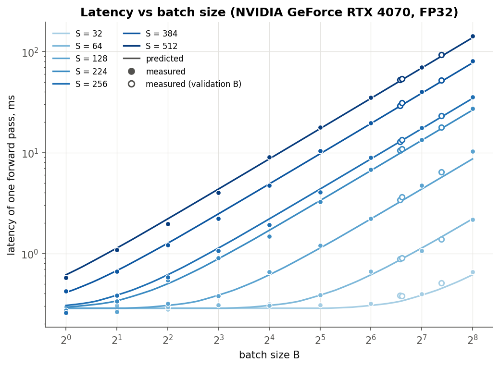
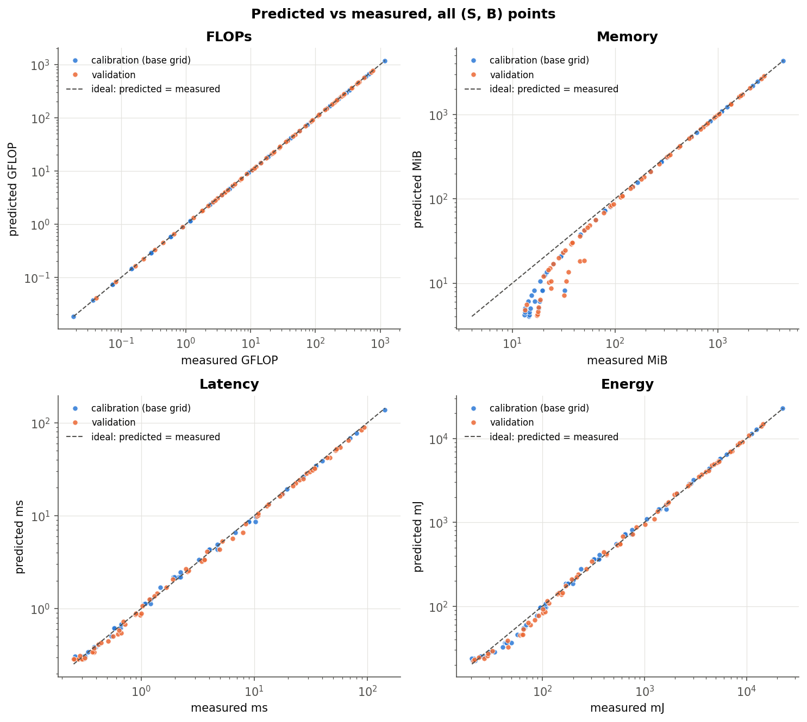
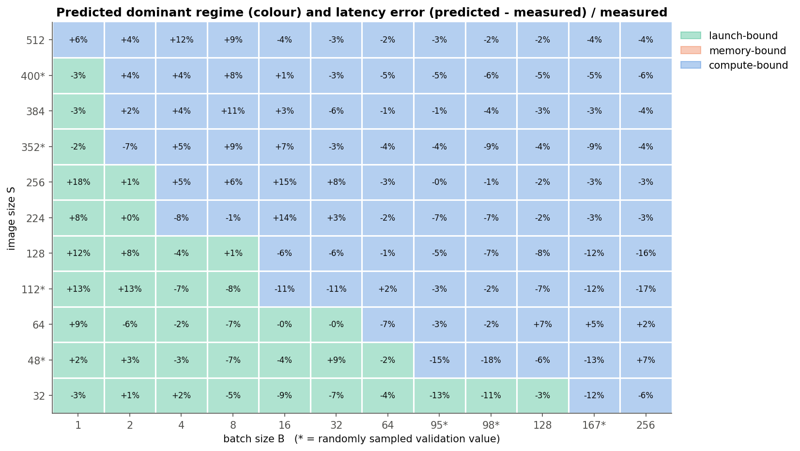
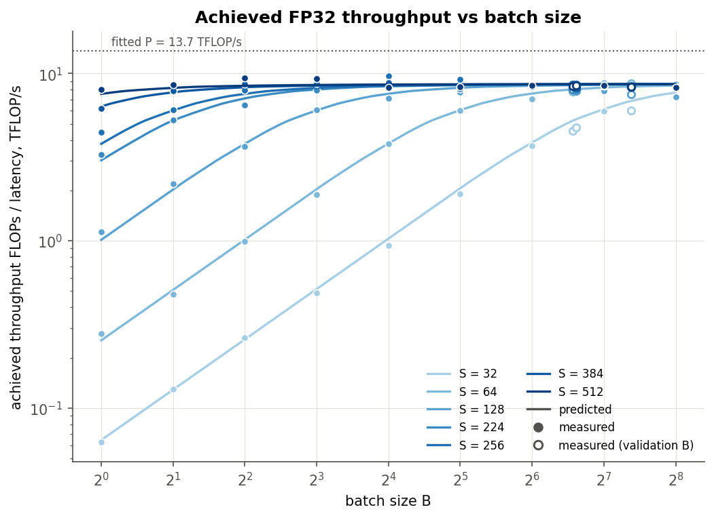
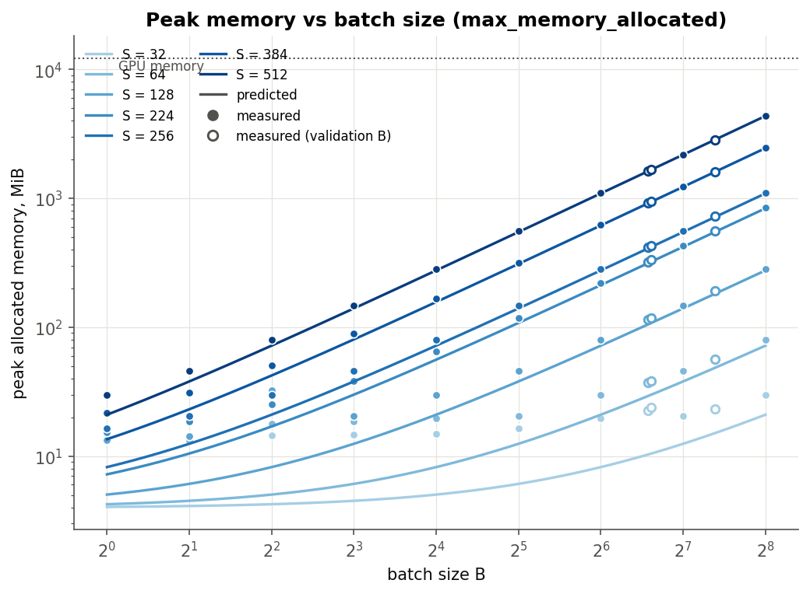
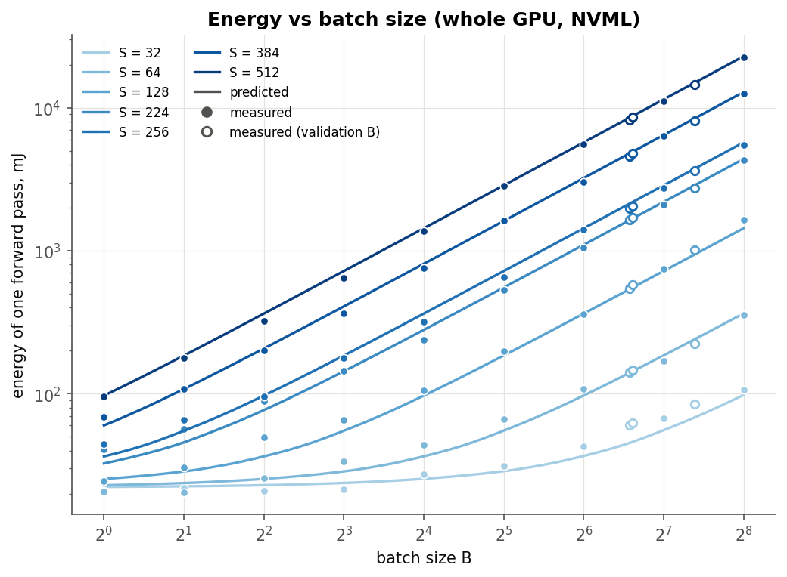
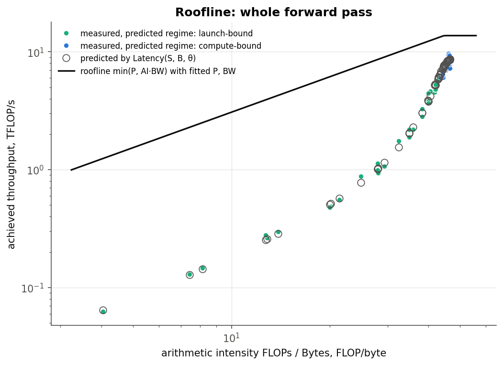
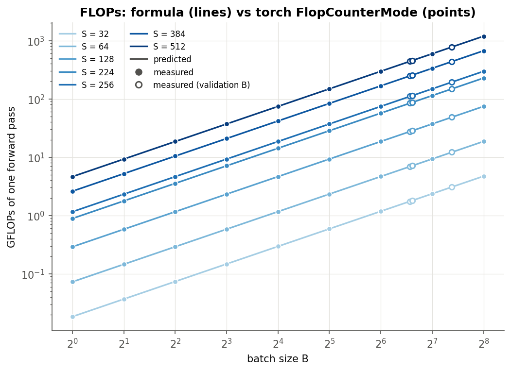

# HW1 — Analytical performance model of a small CNN

Closed-form models of FLOPs, peak memory, latency and energy for a small sequential CNN, calibrated and validated on an RTX 4070. The derivations are in [`hw1_handwritten.pdf`](hw1_handwritten.pdf).

## Setup

| | |
|---|---|
| GPU | NVIDIA GeForce RTX 4070, 12 GB GDDR6X (FP32 peak ≈ 29 TFLOP/s, 504 GB/s, L2 36 MB), power limit 160 W (NVML) |
| Driver | 576.80 |
| Software | Python 3.11.0, PyTorch 2.7.1+cu118, CUDA 11.8, cuDNN 9.1.0 |
| OS | Windows 11 (build 26200) |
| Mode | `eval()`, `torch.inference_mode()`, FP32, `cudnn.benchmark = False`, TF32 disabled |

## How to reproduce

```bash
pip install torch numpy scipy pandas matplotlib nvidia-ml-py
python models.py        # prints the network, 1,040,324 parameters
python equations.py     # control values of the formulas
python measure.py       # ~25 min: 132 configurations -> results/measurements.csv
python calibrate.py     # fit theta on the base grid, errors, figures -> results/theta.json, results/figures/*.png
```

`measure.py --quick` runs a 9-configuration smoke test in about a minute.

**Measurement protocol** (per configuration, random input `torch.randn(B, 3, S, S)`):
- 3 warm-up passes (cuDNN / cuBLAS initialisation);
- **memory**: `reset_peak_memory_stats()` → one forward → `max_memory_allocated()` (weights and input already allocated);
- **latency**: median of ≥ 20 synchronised single passes, at least 1 s in total;
- **energy**: NVML `nvmlDeviceGetTotalEnergyConsumption` over ≥ 2 s of back-to-back synchronised passes, divided by the number of passes. The counter updates every 100 ms, so the window starts and ends on a counter update;
- **FLOPs** also counted with `torch.utils.flop_counter.FlopCounterMode` to check the formula;
- `torch.cuda.OutOfMemoryError` is caught and recorded as `OOM`.

**Grid**: S ∈ {32, 64, 128, 224, 256, 384, 512} ∪ {48, 112, 352, 400}, B ∈ {1, 2, …, 256} ∪ {95, 98, 167}. The extra values are sampled with seed 2026. θ is fitted only on the 63 base-grid points. The 69 points with a random S or a random B are held out for validation (`is_validation`).

## Equations

With S the image size and B the batch size ([`equations.py`](equations.py)):

| Function | Formula |
|---|---|
| `flops(S, B)` | B · (17 712 · S² + 313 344) |
| `memory(S, B)` | 68 · B · S² + W,  W = 4 161 296 bytes (weights) |
| Bytes moved | 380 · B · S² + 8 592 · B + W |
| `latency(S, B, θ)` | Σ over 17 kernels of max(τ, Fᵢ / P, Mᵢ / BW),  θ = (τ, P, BW) |
| `energy(S, B, θ_E)` | P_s · Latency + e_F · FLOPs + e_M · Bytes,  θ_E = (P_s, e_F, e_M) |

Fitting: latency uses non-linear least squares on log(latency), so each point counts by its relative error. Energy is linear in θ_E, so it uses non-negative least squares on relative errors.

## Results

**Fitted parameters** ([`results/theta.json`](results/theta.json)):

| τ (launch cost per kernel) | P (attainable FP32) | BW (attainable DRAM) | P_s | e_F | e_M |
|---|---|---|---|---|---|
| 16.9 µs | 13.7 TFLOP/s (47% of peak) | 308 GB/s (61% of peak) | 69.5 W | 0 pJ/FLOP | 523 pJ/byte |

**Relative error |pred − meas| / meas:**

| | Calibration (63 points): MAPE / max | Validation (69 points): MAPE / max |
|---|---|---|
| FLOPs | 0.0% / 0.0% | 0.0% / 0.0% |
| Memory | 28.1% / 74.6% | 21.9% / 77.3% |
| Latency | 5.2% / 17.6% | 6.1% / 17.8% |
| Energy | 8.4% / 26.7% | 7.5% / 29.6% |

Memory at points where the prediction is above 100 MB (all splits): MAPE 2.6%, max 8.1%.

**OOM**: none of the 132 configurations ran out of memory. The Memory equation predicts none: its largest value is 4.57 GB at (512, 256), and the card has 12 GB. It agrees on 132/132 configurations.

### Figures

| | |
|---|---|
|  |  |
|  |  |
|  |  |
|  |  |

## Discussion

**FLOPs** are exact. `FlopCounterMode` gives the same numbers as the formula at every point, so counting only convolutions and linear layers (1 MAC = 2 FLOPs) is correct.

**Latency: three regimes.**
- **Launch-bound.** For small B·S² the latency is flat at ≈ 0.29 ms, whatever the batch size. For example, S = 32 stays flat up to B ≈ 64. This is 17 kernels × τ ≈ 17 µs. τ is large because on Windows each launch goes through the WDDM driver and Python dispatch. A single forward pass does too little work to hide that cost: at (32, 1) the GPU reaches only 0.06 TFLOP/s.
- **Compute-bound.** Beyond N_k·τ ≈ 0.29 ms of GPU work, the latency grows linearly in B·S². The achieved throughput saturates at 8–9.7 TFLOP/s (throughput figure). The regime map shows the boundary running diagonally: at S = 512 already B = 1 is past it, at S = 32 only B ≥ 167 is.
- **Memory-bound kernels, never dominant.** On the 4070, conv1 and conv4 (AI ≈ 53 and 43 < ridge ≈ 58) and all ReLU/MaxPool kernels are memory-bound. In the calibrated model they take **≈ 41% of the time even at (512, 256)**. That is why the whole network reaches only ≈ 60% of the fitted P. Still, they never outweigh the compute-bound convolutions, so no cell of the regime map is memory-dominated. The transition goes launch → compute, with a large memory-bound share inside the compute regime. Fusing ReLU into the convolutions (for example with `torch.compile`) would remove most of that traffic.

**Where the latency model breaks** (errors up to ±18%):
1. **At the knee between regimes** (for example S = 256, B = 1 → +18%; S = 48, B = 95–98 → −15…−18%). The model switches each kernel sharply between τ and its roofline time. In reality, CPU launch and GPU execution overlap only partially, so the transition is smoother.
2. **Mid-size shapes** (S = 112–128, B = 128–256 → −12…−17%). Here the model is too optimistic. With `cudnn.benchmark = False` the heuristic picks a different convolution algorithm for each shape, and not all of them reach the single fitted P.
3. **Constant P and BW.** The GPU runs at its 160 W power limit (measured 155–160 W at large sizes), so clocks depend on load. The fitted P is therefore a "power-limited" throughput, not the peak.

**Memory** is accurate when activations dominate: within 2.6% on average (max 8%) for predictions above 100 MB, and within 0.2% at (512, 256). This confirms the 68·B·S² term, **including the int64 MaxPool indices**. Without them the coefficient would be 52 and the error would be about 24%. At small sizes the formula underestimates by 8–31 MiB. The two reasons were checked layer by layer:
- **cuBLAS workspace**: exactly **8 519 680 bytes = 8.125 MiB**. The first `nn.Linear` call allocates it and keeps it, per `CUBLAS_WORKSPACE_CONFIG = :4096:2:16:8`.
- **cuDNN workspace**: transient, and it depends on the chosen algorithm (for example ≈ 2.9 MB for conv5 at (32, 1), and up to tens of MB for some shapes).

Both are constants that do not depend on B·S². On a log scale they dominate when the activations are only a few MB. Adding a constant 8.125 MiB would fix most of the small-size error, but the handwritten equation does not include it.

**Energy** follows latency well (MAPE ≈ 8%), but two assumptions fail:
1. **e_F and e_M cannot be separated.** FLOPs and Bytes are both ≈ proportional to B·S² (their correlation over the grid is 0.999999999), so the fit puts all dynamic energy into e_M = 523 pJ/byte and sets e_F = 0. That value is far above physical DRAM energy (≈ 10–60 pJ/byte for GDDR6X). It is an "energy per unit of work" coefficient, not a per-byte cost. Separating them would need workloads with different arithmetic intensity, for example the individual layers.
2. **Power is not "static + proportional to work".** In the launch-bound regime the GPU stays at high clocks and draws 60–150 W while mostly waiting for the CPU. That is why the largest errors (−25…−30%, for example S = 112, B = 4–8 and S = 32, B = 95–98) are underestimates at small and medium sizes. At large sizes the card sits at its 160 W power limit, so energy ≈ 157 W × latency, and the model is accurate there because it is effectively latency × constant power.

**Summary.** The analytical FLOPs and memory models are exact where their assumptions hold. Memory misses only the fixed library workspaces. A three-parameter roofline-with-launch-floor model predicts latency on unseen (S, B) with ≈ 6% MAPE and captures the launch- → compute-bound transition. It misses mostly at the regime knee and where cuDNN changes algorithms. The energy model works mainly because energy ≈ power × latency, and its per-FLOP / per-byte split is not identifiable on this network.

## Files

```
hw1/
├── README.md
├── hw1_handwritten.pdf      # handwritten derivations
├── models.py                # SmallCNN
├── equations.py             # flops(), memory(), latency(), energy() (+ bytes_moved(), regime())
├── measure.py               # measurements
├── calibrate.py             # fitting of theta, validation errors, figures
└── results/
    ├── measurements.csv     # S, B, latency, memory or OOM, energy, is_validation, ...
    ├── theta.json           # fitted parameters, error summary, GPU / software versions
    └── figures/*.png
```
