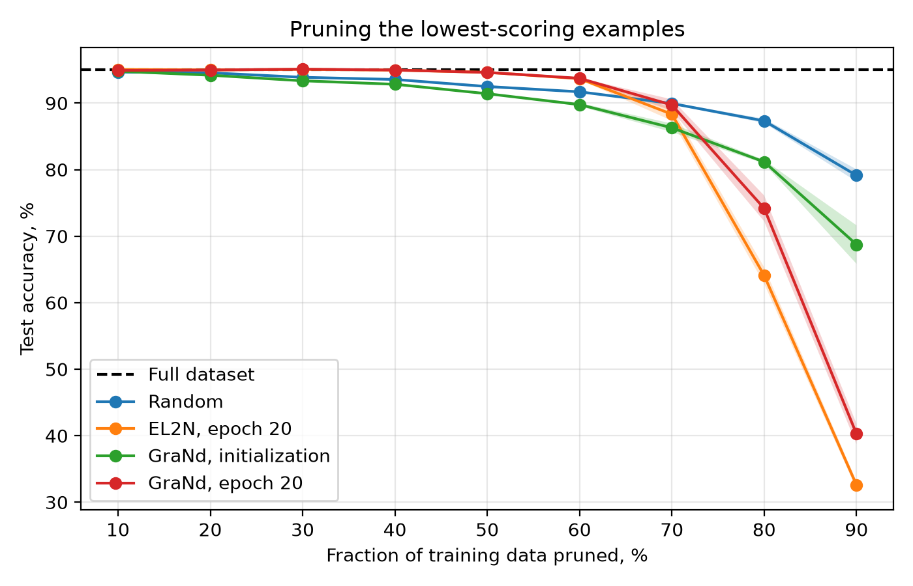
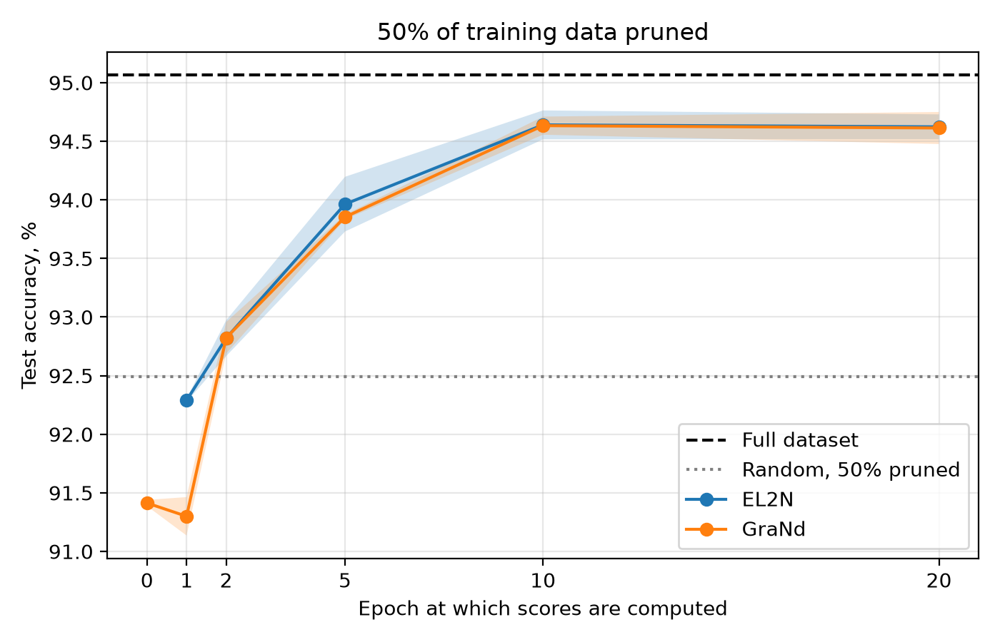
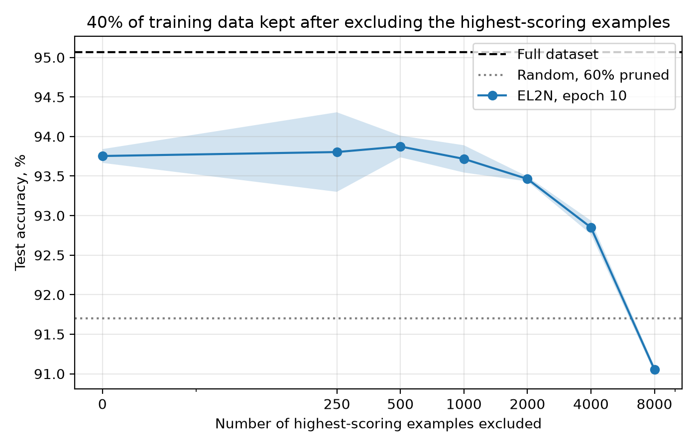
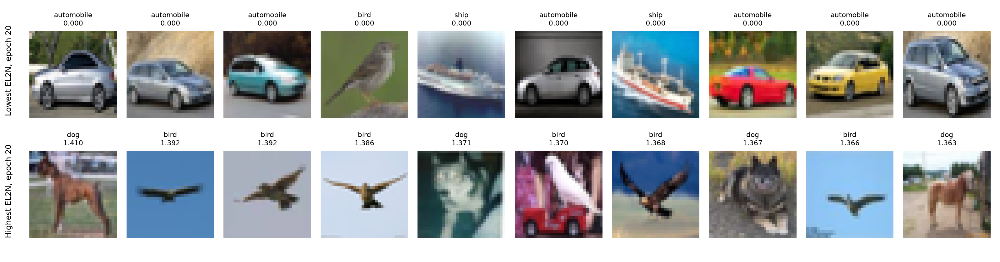

# Reproducing “Deep Learning on a Data Diet”

Amir Nigmatullin · Efficient Neural Networks, homework 2 · October 2026

## Summary

I reproduced the CIFAR-10 part of *Deep Learning on a Data Diet* (Paul, Ganguli and Dziugaite, NeurIPS 2021) with ResNet-18 in PyTorch. The main result holds up well: if you score every training image with EL2N after 20 epochs and throw away the easiest 40%, the network trains to the same test accuracy as on the full dataset. At 50% I lose about half a point, which is still two points better than throwing away a random half. The scores become useful surprisingly early, after only two epochs, and by epoch 10 they are as good as they get.

One claim did not survive. GraNd computed at initialization, before any training, is worse than random selection. This is consistent with the erratum the authors added after Kirsch (2023) found a library bug in the original code. In my runs this score turned out to mostly measure how large the pixel values of an image are.

## 1. What the paper says

The paper starts from a simple question: does a network really need every example in its training set? Some images are so typical that the network learns them in the first few epochs and never looks back. Others are confusing, atypical or simply mislabeled. If we could tell these groups apart early, we could drop the redundant ones and train on less data.

The authors propose two scores for this. **GraNd** is the norm of the loss gradient of a single example, averaged over several random initializations. The motivation is that in one SGD step, the influence of an example on the loss of any other example is bounded by its gradient norm. **EL2N** is the norm of the error vector, the difference between the predicted probabilities and the one-hot label, again averaged over initializations. After a few epochs EL2N closely tracks GraNd, and it only needs a forward pass.

I tested four claims from the paper:

1. Pruning the lowest-scoring 50% of CIFAR-10 by EL2N or GraNd at epoch 20 costs no test accuracy.
2. GraNd works even at initialization.
3. The scores are informative after only a few epochs of training.
4. The very hardest examples are often noise, so a training subset that skips a few hundred of them works better.

## 2. What I ran

I followed the training recipe from the paper as closely as I could:

| | |
| --- | --- |
| Data | CIFAR-10, 50,000 training and 10,000 test images |
| Model | ResNet-18 for 32×32 inputs |
| Training | SGD, lr 0.1, Nesterov momentum 0.9, weight decay 5e-4, batch 128, 200 epochs, lr × 0.2 at epochs 60, 120 and 160 |
| Augmentation | random crop with 4-pixel padding, horizontal flip |
| Scores | averaged over 10 networks with different seeds, saved at epochs 0, 1, 2, 5, 10 and 20 |
| Evaluation | 3 fresh seeds per point (the paper uses 4), mean ± standard deviation |

Every pruning experiment works the same way. I sort the training set by score, drop the lowest-scoring fraction, and train a new network from a new random seed on what is left. The baselines are training on all the data and training on a random subset of the same size.

In total this came to 156 training runs. To make that feasible I kept the whole training set on the GPU and did the augmentation there as well, which brought an epoch down to about 8 seconds on an RTX 4070 and let several runs share one GPU. I tested the pipeline on the 4070 with a shortened configuration and ran the full grid on one MIG slice of an NVIDIA H200 at work, with several runs in parallel.

GraNd needs a separate gradient for every one of the 50,000 images. I computed these with `torch.func` (`vmap` over `grad`), which was the most memory-hungry part of the project. My first launch on the server crashed with an out-of-memory error, which on a MIG slice PyTorch reports as an obscure NVML assertion. Computing the per-example gradients in chunks of 32 images (down from 128) fixed it.

One detail matters for GraNd at initialization. An untrained network has no meaningful BatchNorm statistics, so before computing this score I ran the training set through a copy of the network to estimate them. For all trained networks I used the normal running statistics.

## 3. Results

### 3.1 How much data can we throw away?



*Figure 1. Test accuracy after removing the lowest-scoring fraction of CIFAR-10. The dashed line is training on all the data, the bands show ±1 standard deviation over 3 seeds.*

| Pruned | Random | EL2N, epoch 20 | GraNd, init | GraNd, epoch 20 |
| --- | --- | --- | --- | --- |
| 10% | 94.67 ± 0.24 | 95.06 ± 0.15 | 94.79 ± 0.17 | 94.92 ± 0.16 |
| 20% | 94.55 ± 0.07 | 94.99 ± 0.14 | 94.19 ± 0.17 | 94.97 ± 0.17 |
| 30% | 93.88 ± 0.04 | 95.07 ± 0.15 | 93.36 ± 0.17 | 95.10 ± 0.08 |
| 40% | 93.55 ± 0.07 | 94.96 ± 0.16 | 92.83 ± 0.04 | 94.97 ± 0.03 |
| 50% | 92.49 ± 0.19 | 94.62 ± 0.11 | 91.41 ± 0.03 | 94.61 ± 0.14 |
| 60% | 91.70 ± 0.12 | 93.68 ± 0.15 | 89.78 ± 0.25 | 93.73 ± 0.06 |
| 70% | 89.94 ± 0.15 | 88.33 ± 0.97 | 86.29 ± 0.64 | 89.72 ± 0.85 |
| 80% | 87.33 ± 0.32 | 64.08 ± 1.25 | 81.17 ± 0.28 | 74.17 ± 1.94 |
| 90% | 79.13 ± 0.92 | 32.58 ± 0.56 | 68.74 ± 2.89 | 40.27 ± 1.54 |

*Table 1. Test accuracy, %. Training on all data gives 95.07 ± 0.13.*

Up to 40% pruning the trained scores are indistinguishable from the full dataset. Random pruning loses 1.5 points over the same range. At 50% EL2N gives 94.62%, which is 0.45 points below full data but 2.1 points above a random half. The paper reports no loss at all at 50%, so my result is slightly weaker, but the picture is clearly the same.

EL2N and GraNd at epoch 20 behave almost identically. Their rankings have a Spearman correlation of 0.982, so once the network has trained for a while, the cheap score is as good as the expensive one.

The more interesting part of the plot is on the right. From 70% pruning onward, keeping only the hardest examples is worse than random selection, and at 90% it collapses to 32.6% against 79.1%. The paper shows the same sharp drop and explains it by poor coverage: when only the hardest images remain, whole groups of ordinary examples disappear from training, even though they still appear in the test set. Sorscher et al. (2022) later made this precise: when little data is left, the easy examples should be kept.

### 3.2 GraNd at initialization

This is the claim that did not reproduce. GraNd computed before any training is worse than random pruning at every fraction from 20% to 90%. At 50%, for example, it gives 91.41% against 92.49%. At 10% it is 0.12 points above random, which is well within the noise.

The reason became clear when I looked at what this score actually measures. Its Spearman correlation with the L2 norm of the (normalized) input image is 0.855, while its correlation with EL2N after training is close to zero:

| Score A | Score B | Spearman ρ |
| --- | --- | --- |
| GraNd, init | input norm | 0.855 |
| GraNd, init | EL2N, epoch 20 | −0.066 |
| GraNd, epoch 20 | input norm | −0.035 |
| EL2N, epoch 20 | GraNd, epoch 20 | 0.982 |

*Table 2. Rank correlations between scores over all 50,000 training images.*

An untrained network knows nothing about the classes, so the size of its gradient is driven mainly by the size of the input. Pruning by this score removes low-contrast images, which has little to do with how useful they are. After 20 epochs the correlation with input norm is gone. Kirsch (2023) reached exactly the same conclusion, and the current version of the paper states that scores at initialization do not work.

### 3.3 How early do the scores work?



*Figure 2. Test accuracy with 50% of CIFAR-10 removed, depending on when the scores are computed. The dotted line is random pruning.*

| Score epoch | EL2N | GraNd |
| --- | --- | --- |
| 0 | n/a | 91.41 ± 0.03 |
| 1 | 92.29 ± 0.01 | 91.30 ± 0.16 |
| 2 | 92.82 ± 0.15 | 92.82 ± 0.13 |
| 5 | 93.96 ± 0.23 | 93.85 ± 0.02 |
| 10 | 94.64 ± 0.12 | 94.63 ± 0.08 |
| 20 | 94.62 ± 0.11 | 94.61 ± 0.14 |

*Table 3. Test accuracy at 50% pruning, %. Random pruning gives 92.49 ± 0.19.*

This is the part of the paper I found most convincing. After one epoch the scores are still useless, slightly below random. After two epochs both beat random, and by epoch 10 they reach the same accuracy as at epoch 20. So the title of the paper is fair: the important examples really can be found early.

It is worth keeping the cost in mind, though. Ten networks trained for ten epochs is 100 epochs of compute, half of one full training run. Data pruning only saves time if the pruned dataset is used for several trainings afterwards.

### 3.4 Should we also drop the hardest examples?



*Figure 3. Training on 40% of the data (20,000 images), skipping the k highest-scoring images by EL2N at epoch 10 and keeping the next 20,000. The x-axis is symmetric-logarithmic.*

| Hardest images skipped | Test accuracy, % |
| --- | --- |
| 0 | 93.75 ± 0.09 |
| 250 | 93.80 ± 0.50 |
| 500 | 93.87 ± 0.14 |
| 1,000 | 93.72 ± 0.17 |
| 2,000 | 93.46 ± 0.03 |
| 4,000 | 92.85 ± 0.09 |
| 8,000 | 91.05 ± 0.04 |

*Table 4. Sliding window results. A random 40% of the data gives 91.70 ± 0.12.*

The paper reports that the best training subset leaves out about 500 of the hardest examples. I got the best result at exactly 500 as well, which was a nice moment. To be honest, though, the gain over skipping nothing is only 0.12 points, smaller than the spread between seeds, so three seeds are not enough to call this a real effect. Skipping more than 1,000 images clearly hurts, and at 8,000 the subset is worse than random. The paper shows a much stronger effect when 10% of the labels are randomized, which I did not have time to run.

### 3.5 What the hardest images look like



*Figure 4. Top row: the ten training images with the lowest EL2N at epoch 20. Bottom row: the ten with the highest. The label is shown above each image.*

This figure explains the whole paper better than any table. The easiest images are textbook cars and ships with a score of essentially zero. The hardest ones are a mix of odd and simply wrong examples: several images labeled “dog” look like a cat or a horse, and one “bird” is mostly a red truck. It is easy to see why the network learns nothing from the first group and why the second group can hurt.

## 4. Did it reproduce?

- **Pruning 50% of CIFAR-10 without loss:** mostly yes. No loss up to 40%, −0.45 points at 50%, still well ahead of random pruning.
- **GraNd at initialization:** no. Worse than random, because it mostly measures the input norm. This agrees with the erratum and with Kirsch (2023).
- **Scores work early:** yes. Better than random from epoch 2, full effect by epoch 10.
- **Skipping the hardest examples helps:** the optimum is at the same place as in the paper, but the effect on clean labels is too small to confirm with three seeds.

## 5. What I left out and what I did differently

I only covered CIFAR-10 with ResNet-18. The paper also uses CIFAR-100, CINIC-10 and ResNet-50, compares against forgetting scores (Toneva et al., 2019), repeats the sliding window with noisy labels, and has a whole section on training dynamics (NTK velocity and linear mode connectivity). None of that is in this reproduction.

The differences in my setup are small: PyTorch with bf16 mixed precision (the paper uses JAX and Flax), 3 evaluation seeds per point (the paper uses 4) with standard deviations (the paper shows percentile bands), and the BatchNorm handling for GraNd at initialization described above.

## 6. Takeaways

If I had to use this method in practice, I would train a few networks for about ten epochs, average EL2N, and prune moderately, somewhere around a third of the data. I would not go beyond half, because the hard-only subsets fall apart quickly, and I would not trust any score computed before training. The most useful thing I took away from this project is how lopsided a standard dataset is: a large part of CIFAR-10 is redundant, and the hardest corner of it is full of label noise.

## How to run the code

The code is in seven files: `config.py` holds all hyperparameters, `data.py`, `model.py` and `scores.py` contain the data pipeline, the network and the two scores, `train.py` runs a single scoring or training job, `run_all.py` runs the whole grid and skips finished jobs, and `plot.py` makes the figures and tables.

```
pip install -r requirements.txt
python run_all.py --workers 4
```

`python run_all.py --smoke --workers 2` runs a shortened version of everything in a few minutes, which is useful for checking the setup.

## References

1. M. Paul, S. Ganguli, G. K. Dziugaite. Deep Learning on a Data Diet: Finding Important Examples Early in Training. NeurIPS 2021. arXiv:2107.07075.
2. A. Kirsch. Does “Deep Learning on a Data Diet” Reproduce? Overall Yes, but GraNd at Initialization Does Not. arXiv:2303.14753, 2023.
3. M. Toneva, A. Sordoni, R. Tachet des Combes, A. Trischler, Y. Bengio, G. J. Gordon. An Empirical Study of Example Forgetting during Deep Neural Network Learning. ICLR 2019.
4. B. Sorscher, R. Geirhos, S. Shekhar, S. Ganguli, A. S. Morcos. Beyond Neural Scaling Laws: Beating Power Law Scaling via Data Pruning. NeurIPS 2022.
5. K. He, X. Zhang, S. Ren, J. Sun. Deep Residual Learning for Image Recognition. CVPR 2016.
6. A. Krizhevsky. Learning Multiple Layers of Features from Tiny Images. Technical report, 2009.
